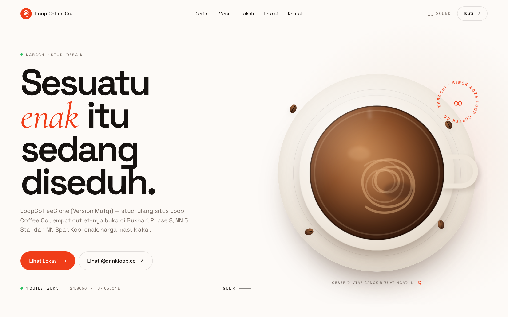
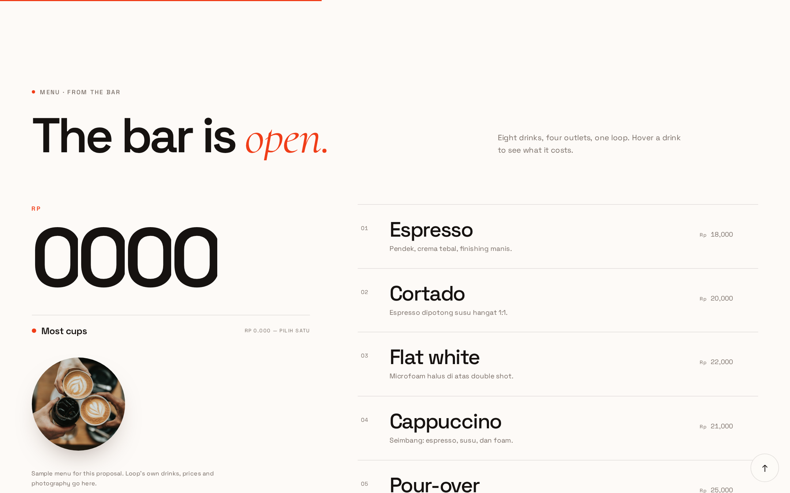
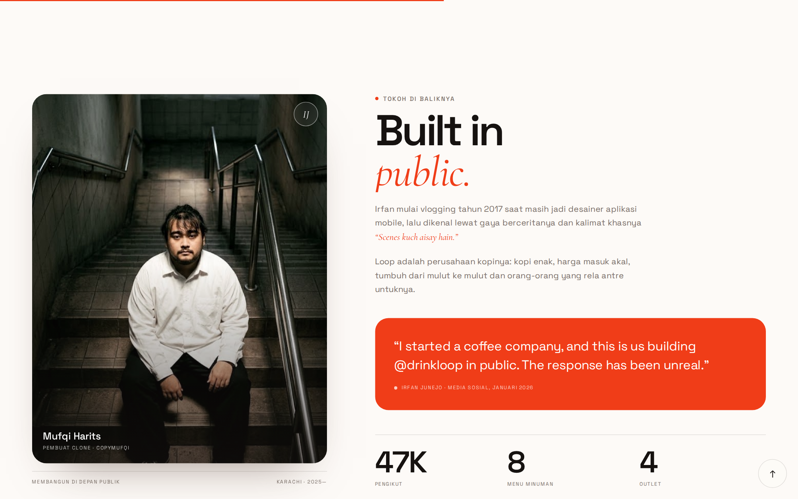
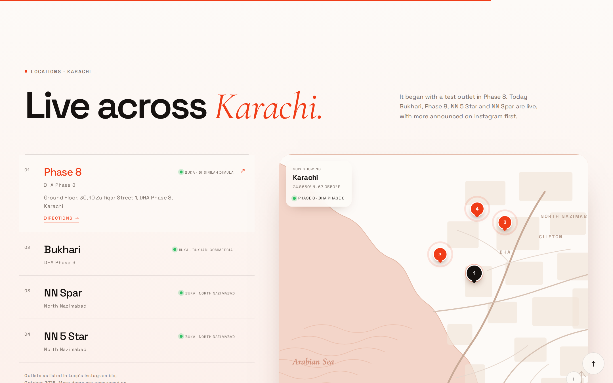

# LoopCoffeeClone — Version Mufqi ☕

A study clone of the [Loop Coffee Co.](https://drinkloop.co) website, rebuilt piece by piece for one simple reason: I was unemployed, bored out of my mind, saw [Irfan Junejo](https://instagram.com/drinkloop.co)'s site and thought *"this is insanely well-made"* — so I tried building it myself to learn how it works.

**🔗 Live demo:** https://otaku.agenticindonesia.run.place *(temporary hosting on my home lab VPS — may be offline)*

<p align="center">
  
</p>

---

## Why this exists

This started as one of those "I wonder if I can do that" projects. No client, no deadline, no reason — just an idle brain and a website I couldn't stop scrolling.

All credit for the original design and concept goes to **Irfan Junejo** and the Loop Coffee Co. team. This repo is purely a learning exercise: reverse-engineering the layout, animations, and interactions to understand how a polished editorial site is built. It is **not affiliated with** and **not a replacement for** the original.

<p align="center">
  
</p>

## What I learned (and what's inside)

- **React + Vite** — component structure for a long-scroll editorial page
- **GSAP + ScrollTrigger** — scroll-pinned storytelling, reveal animations, staggered line masks
- **Lenis** — smooth scrolling that doesn't fight the browser
- **Interactive SVG** — the stirrable coffee cup in the hero (drag to swirl the latte art, with physics-ish momentum)
- **Custom cursor, marquee bands, loader** — the little details that make a site feel alive

Everything is in `src/components/` — each section is a self-contained component, and all the copy lives in `src/data.js` if you want to see how the content model works.

<p align="center">
  
</p>

## What I changed from the original

Since this is my study version:

- Copy is rewritten in **Bahasa Indonesia** (my version of the voice)
- Prices converted to **Rupiah**
- Photo of the "founder" replaced with me, sitting on a staircase, thinking about loops
- Dual clocks in the footer: Karachi (homage) and Jakarta (home)
- Credit line in the footer pointing back to the original project — because clone culture without attribution is just theft with extra steps

## Run it yourself

```bash
npm install
npm run dev      # local dev server
npm run build    # production build to dist/
```

<p align="center">
  
</p>

## Credits

- **Original site & brand:** [Loop Coffee Co.](https://drinkloop.co) by [Irfan Junejo](https://instagram.com/drinkloop.co) — go look at the real thing, it's better than mine
- **This clone:** [Mufqi Harits](https://linkedin.com/in/mufqi-h-40b02b219) — built for learning, served with ☕

---

*© 2026 CopyMufqi — study project. Loop Coffee Co. and all original assets belong to their respective owners.*
